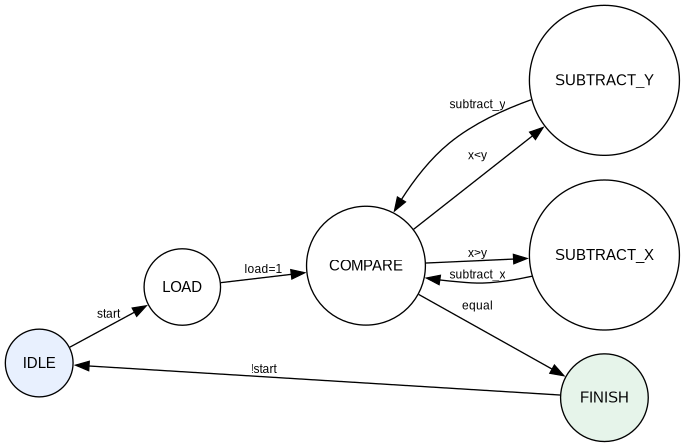
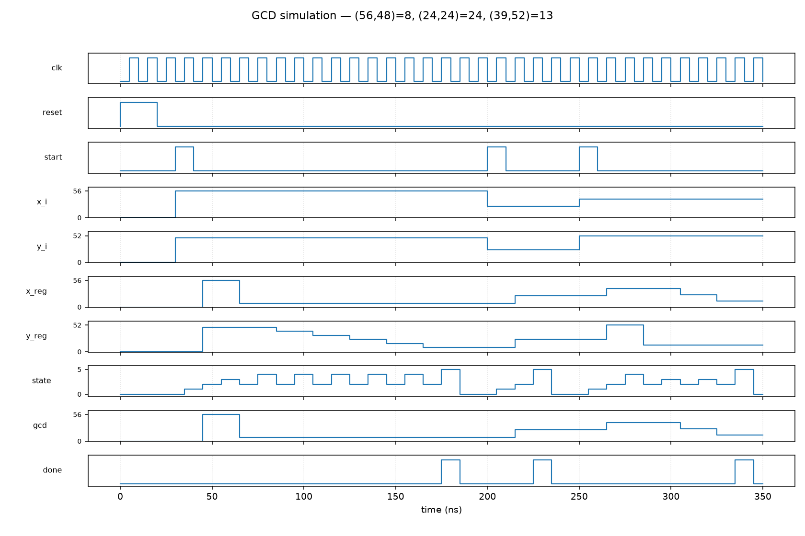

# Lab Report: Iterative GCD with Separate Datapath and Controller

**Design:** Euclidean GCD by repeated subtraction  
**Top module:** `gcd_top`  
**Operand width:** 6-bit (`x_i`, `y_i`, `gcd`)  
**Tools:** Icarus Verilog (simulation), Quartus Prime Pro 26.1.1 (synthesis)

---

## 1. Objective

The goal of this lab was to implement the GCD problem discussed in lecture as a digital hardware design. The requirement was not just to “write a GCD module,” but to split the design cleanly into:

1. a **datapath** that holds the operands and does the arithmetic, and  
2. a **controller** FSM that decides *when* to load, compare, and subtract,

then wire both together in a top-level module. After that, the design had to be simulated for three given input pairs and synthesized in Quartus so that the tool could extract the state machine from the controller.

For the given input scale, 6 bits are enough: the largest value among the test cases is 56, which fits comfortably in `0 … 63`.

---

## 2. Algorithm

We used the subtractive form of Euclid’s algorithm:

```text
while x ≠ y:
    if x > y:  x ← x − y
    else:      y ← y − x
return x   // (same as y when they become equal)
```

This maps naturally onto hardware: two registers, a comparator, and a subtractor, plus a small FSM that loops until the values match.

Expected results for the required test vectors:

| Inputs `(x, y)` | Expected GCD |
| --------------- | ------------ |
| `(56, 48)`      | `8`          |
| `(24, 24)`      | `24`         |
| `(39, 52)`      | `13`         |

The equal-input case `(24, 24)` is useful because the FSM should go straight from COMPARE to FINISH without any subtracts.

---

## 3. Architecture

The RTL is split across three files:

| File | Module | Role |
| ---- | ------ | ---- |
| `design/gcd_datapath.v` | `gcd_datapath` | Registers + subtract / load logic |
| `design/gcd_controller.v` | `gcd_controller` | FSM and control strobes |
| `design/gcd_top.v` | `gcd_top` | Instantiates both and connects status ↔ control |

### 3.1 Datapath

The datapath keeps two 6-bit registers, `x_reg` and `y_reg`. On each clock edge it does one of:

- **reset** → clear both registers  
- **load** → copy `x_i` / `y_i` into the registers  
- **subtract_x** → `x_reg ← x_reg − y_reg`  
- **subtract_y** → `y_reg ← y_reg − x_reg`

The current register values are exported as `x_value` / `y_value` so the controller (via the top) can form the status flags. The result port `gcd` is simply `x_reg` (when the algorithm finishes, `x_reg == y_reg`).

### 3.2 Controller

The controller is a Moore-style FSM with six states:

| State | Action |
| ----- | ------ |
| `IDLE` | Wait for `start` |
| `LOAD` | Assert `load` for one cycle, then go to COMPARE |
| `COMPARE` | Branch on `equal` / `x_greater` |
| `SUBTRACT_X` | Assert `subtract_x`, return to COMPARE |
| `SUBTRACT_Y` | Assert `subtract_y`, return to COMPARE |
| `FINISH` | Assert `done`; return to IDLE when `start` is released |

Status inputs into the FSM:

- `equal` ← `(x_value == y_value)`  
- `x_greater` ← `(x_value > y_value)`

Those comparisons are done in the top module so the controller stays a pure control block.

### 3.3 Top-level integration

`gcd_top` is only glue: it instantiates the controller and datapath, forms the comparator flags, and exposes the external ports (`clk`, `reset`, `start`, `x_i`, `y_i`, `gcd`, `done`). Quartus synthesizes this top entity, so the FSM inside the controller is still visible to the synthesizer.

Hand-drawn style view of the control flow (also saved as `reports/gcd_fsm_diagram.png`):



---

## 4. Simulation

### 4.1 Testbench

The testbench `tb/tb_gcd.v` drives the three required datasets through a reusable `check_gcd` task. For each pair it:

1. applies `x_i` / `y_i` and pulses `start`,  
2. waits until `done` (with a timeout),  
3. checks that `gcd` matches the expected value,  
4. prints the cycle count.

Simulation was run with:

```bash
make gcd-run
```

Console output:

```text
GCD(56, 48) = 8 (completed in 14 cycles)
GCD(24, 24) = 24 (completed in 2 cycles)
GCD(39, 52) = 13 (completed in 8 cycles)
GCD TEST PASSED
```

That matches the hand calculation. `(24, 24)` finishing in only two cycles (LOAD → COMPARE → FINISH) is a good sanity check that the equal-path is correct and that we are not doing unnecessary subtracts.

### 4.2 Waveform snapshot

A VCD dump (`gcd_waveform.vcd`) was generated during simulation. The plot below shows `clk`, `reset`, `start`, the inputs, the internal registers, the FSM `state`, and the `gcd` / `done` outputs across all three tests:



What the waveform shows, briefly:

- After reset, the first `start` loads `(56, 48)`. The registers then walk down by repeated subtraction until both hold `8`, and `done` rises.  
- The second test loads `(24, 24)`. No subtract states are needed; `done` asserts quickly with `gcd = 24`.  
- The third test loads `(39, 52)`. `y` is reduced first, then `x`, until both reach `13`.

The GTKWave save file `gcd_waveform.gtkw` can be reopened with:

```bash
gtkwave gcd_waveform.vcd gcd_waveform.gtkw
```

---

## 5. Synthesis (Quartus)

### 5.1 Why synthesize the top level?

Lecture pointed out that when the top module is synthesized, Quartus can recognize the controller’s state register and report it as a formal state machine. That is useful both as a check that the FSM was coded in a synthesizable style, and as a figure for the report (State Machine Viewer / FSM report section).

### 5.2 How to run it

A project already lives under `design/GCD/`. The runnable synthesis script is:

```bash
cd design/GCD
quartus_sh -t synthesize_gcd.tcl
```

Or from the repo root (if `quartus_sh` is on `PATH`):

```bash
make gcd-quartus
```

On this machine Quartus Pro is installed at `/home/ammar/altera_pro/26.1.1/quartus/bin/`, so an equivalent command is:

```bash
cd design/GCD
/home/ammar/altera_pro/26.1.1/quartus/bin/quartus_sh -t synthesize_gcd.tcl
```

What the script does:

1. Opens / creates the `gcd` Quartus project  
2. Adds `gcd_datapath.v`, `gcd_controller.v`, and `gcd_top.v`  
3. Sets the top entity to **`gcd_top`** (this was wrong in an earlier empty project setup, which is why a previous run failed with “Top-level design entity gcd is undefined”)  
4. Targets Agilex 5 / `A5EA005BB15AE4S`  
5. Runs Analysis & Synthesis  
6. Writes a short summary under `design/GCD/reports/`

### 5.3 Results

Synthesis completed successfully. Quartus did extract the controller FSM:

| Item | Value |
| ---- | ----- |
| FSM name | `controller\|state` |
| Number of states | 6 |
| Encoding | Safe One-Hot |
| Approx. ALMs | 25 / 17,100 (< 1 %) |
| Dedicated registers | 18 |

The tool also printed:

```text
Info (284007): State machine "controller|state" will be implemented as a safe
state machine. File: .../gcd_controller.v Line: 20
```

Hierarchy numbers line up with the RTL split: the datapath accounts for the two 6-bit registers (12 flops), and the controller accounts for the one-hot state bits. The original binary `state[2:0]` encoding from the RTL was replaced during synthesis by a safe one-hot encoding — that is expected with Quartus’ default state-machine processing.

The FSM encoding / transition table from the synthesis report is copied in
`reports/gcd_fsm_quartus.txt`. Re-running the Quartus script regenerates
`output_files/gcd.syn.rpt` locally (that directory is gitignored).

### 5.4 State Machine Viewer (GUI snapshot)

After synthesis, open the project and capture the FSM view for submission:

1. Open `design/GCD/gcd.qpf` in Quartus  
2. **Tools → Netlist Viewers → State Machine Viewer**  
3. Select **`controller|state`**  
4. Take a screenshot and attach it next to the report figures  

The same information also appears under  
**Compilation Report → Analysis & Synthesis → State Machines**.

The Graphviz diagram in Section 3 matches the RTL transitions that Quartus recognized (IDLE, LOAD, COMPARE, SUBTRACT_X, SUBTRACT_Y, FINISH).

---

## 6. Discussion / notes

- Separating datapath and controller made the design easier to reason about. All “what to do to the registers” decisions live in the FSM; the datapath never looks at `start` or `done`.  
- 6-bit width was enough for this lab. Widening to 8 or 16 bits would only change the register / subtractor size; the controller would stay the same.  
- Cycle counts grow with how far apart the operands are, because we subtract 1× the smaller value each time. A modulo-based Euclidean algorithm would finish faster for large gaps, but the subtract version matches what was discussed in lecture and keeps the datapath simple.  
- The Agilex 5 build warns about Reset Release IP. That warning is about device configuration best practice and does not affect the functional FSM / datapath result for this lab.

---

## 7. Files submitted / used

| Path | Description |
| ---- | ----------- |
| `design/gcd_datapath.v` | Datapath RTL |
| `design/gcd_controller.v` | Controller FSM RTL |
| `design/gcd_top.v` | Top-level integration |
| `tb/tb_gcd.v` | Testbench for the three datasets |
| `design/GCD/synthesize_gcd.tcl` | Quartus synthesis script |
| `design/GCD/gcd.qpf` / `gcd.qsf` | Quartus project |
| `design/GCD/reports/gcd_simulation_snapshot.png` | Simulation waveform figure |
| `design/GCD/reports/gcd_fsm_diagram.png` | FSM bubble diagram |
| `design/GCD/reports/gcd_fsm_quartus.txt` | Quartus FSM report extract |
| `scripts/plot_gcd_waveform.py` | Regenerates the simulation snapshot PNG |

---

## 8. Conclusion

The GCD design was implemented with a clear datapath / controller split, integrated in `gcd_top`, and verified on `(56,48)`, `(24,24)`, and `(39,52)`. All three tests passed. Quartus synthesis of the top level successfully inferred the six-state controller FSM (`controller|state`) with safe one-hot encoding, which can be viewed and exported from the State Machine Viewer for the lab attachment.
